# Isometrics

Build animated 3D miniature worlds that show your data: drop in buildings, vehicles and trees, draw roads, bridges, water, parks and raised land, label it all with your numbers, and present the result as a living map of your business.

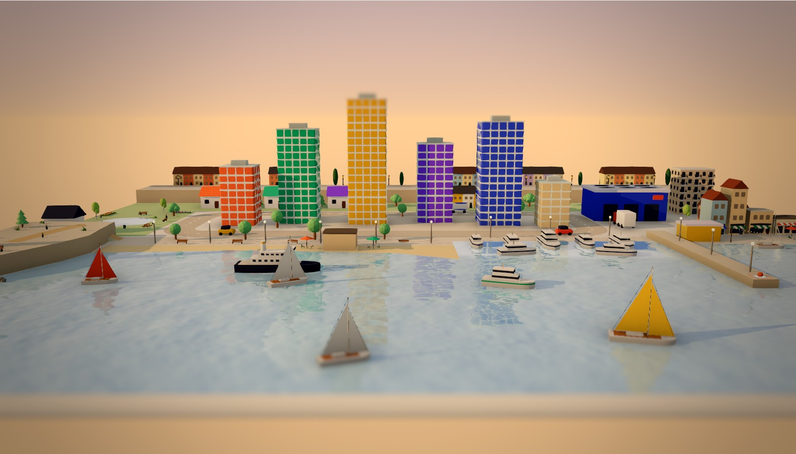

## Gallery

| | |
|---|---|
| 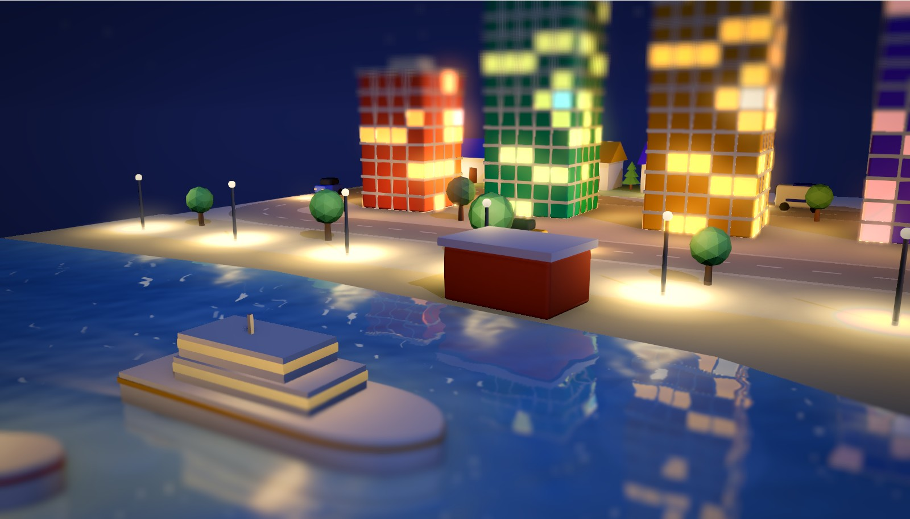 | 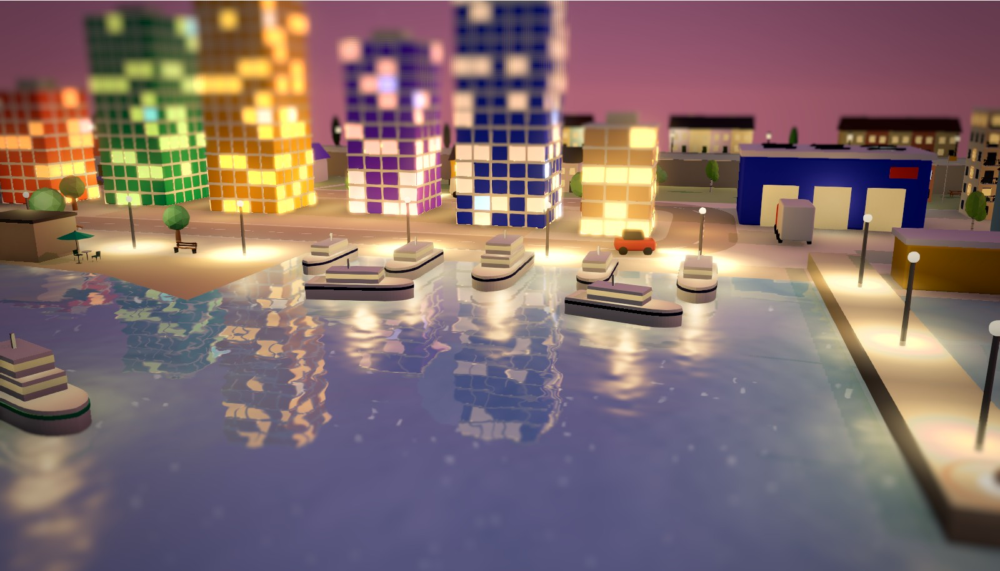 |
| 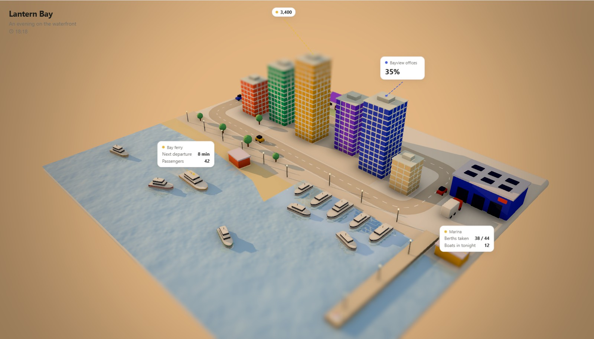 | 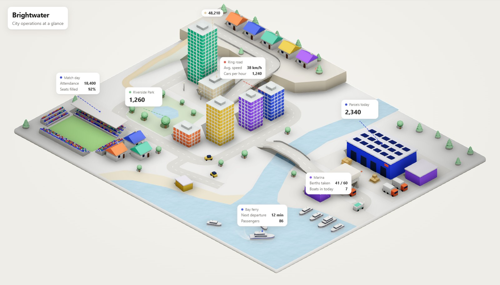 |
| 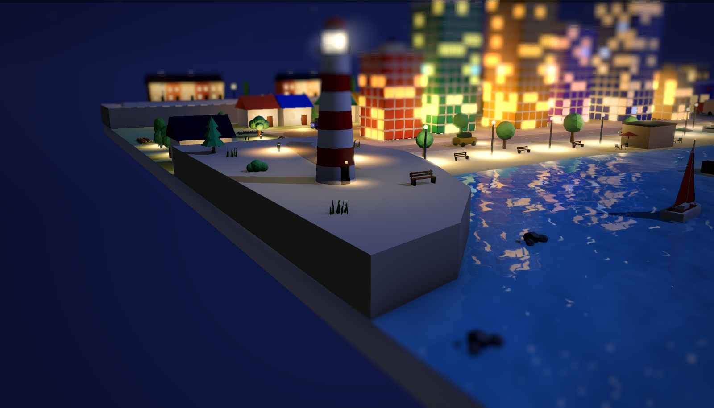 | 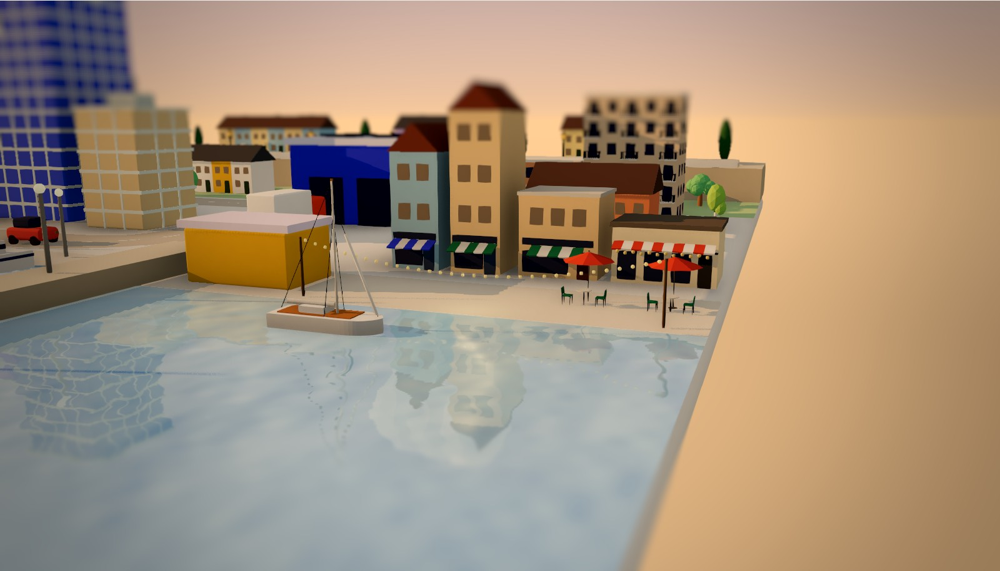 |
| 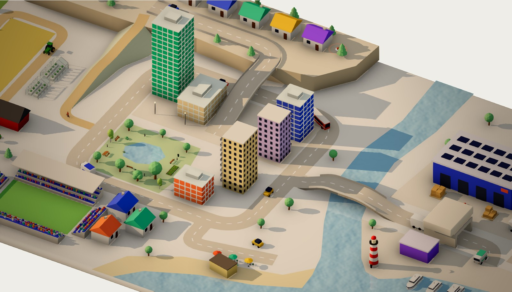 | 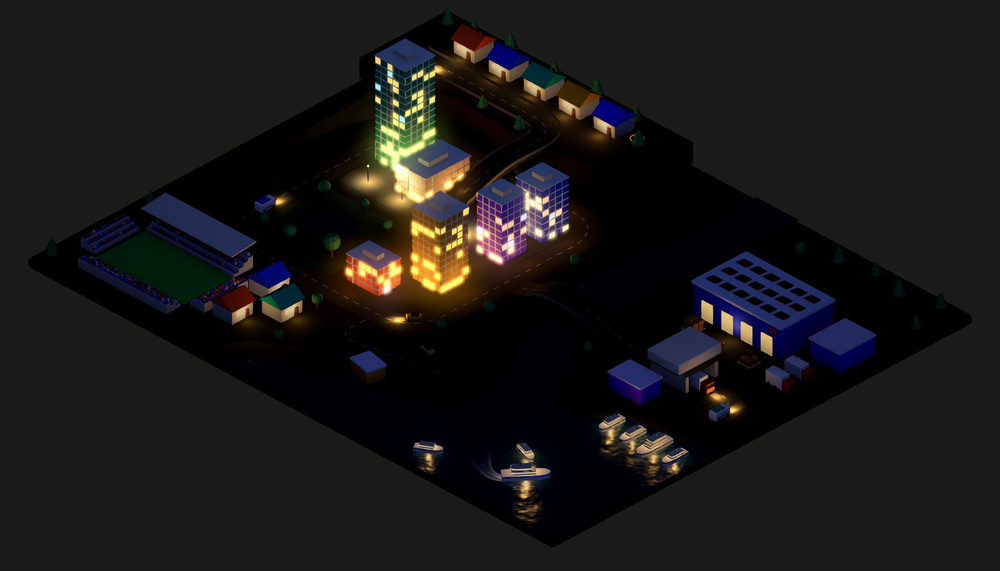 |
| 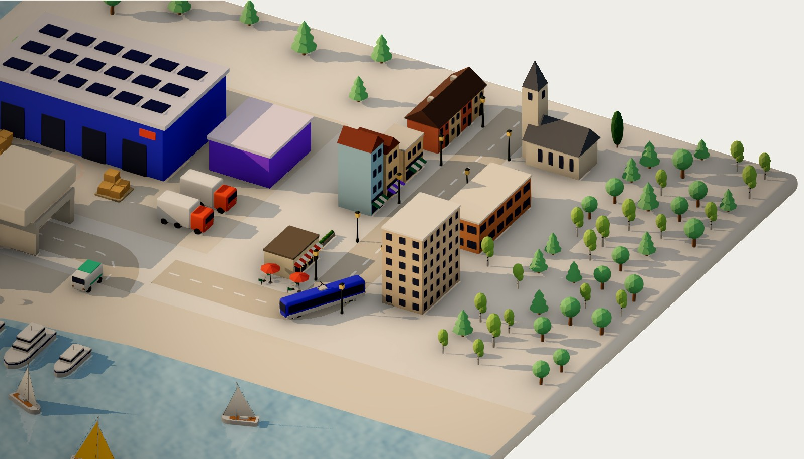 | 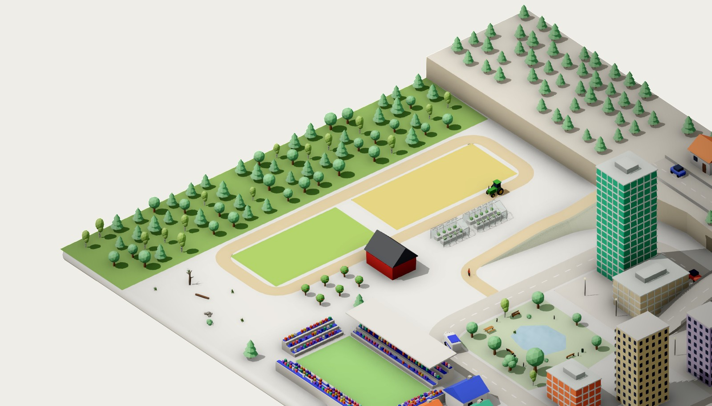 |

Drawn on the Ultra graphics preset. `node scripts/gallery.mjs` retakes them all (on WSL with Windows' node, `node.exe`, for the real GPU) from a running `pnpm dev`.

## Quick start

```bash
pnpm install
pnpm dev          # http://localhost:3000
```

The app opens with **Brightwater**, a small harbour city that shows off most of the editor (bridge, flyover, hill, stadium, marina, live data cards). Your work autosaves in the browser; the **File** menu starts a new empty world or a template, and opens or saves worlds as `.json` files. The file format is published as JSON Schema at `/schema.json`, with every part kind, its props and a short guide, and the templates are served as complete worlds at `/templates.json`, so you (or your AI) can write worlds by hand and open them. `/parts` is a catalogue of every part, with pictures in both themes by day and at night, and each part's colours, lights and settings.

## Using the editor

| Action | How |
|---|---|
| Add an object | Click it in the left **Add to scene** panel (it lands at a free spot; hover a tile for a turning 3D preview, and drag the panel's edge to widen it), or drag it onto the scene to place it exactly (**Esc** cancels), or search it: press **/**, type (e.g. "boat"), **Enter** adds the first match |
| Move the camera | Drag to pan (the ground follows the cursor), right-drag or **Ctrl**/**Shift**+drag to orbit around the point you grab (from straight above to low over the ground), scroll to zoom towards the cursor. Drags never select or move anything; the re-centre button in the top bar goes back to the iso view. **P** (or the cube button) switches between the diorama view and a perspective one |
| Viewpoints | **Views** in the toolbar (or keys **1**–**9**) glides to a saved view; *Save the current view* adds one, and the **Viewpoints** tab renames, re-saves, describes, reorders (drag the grip) or deletes them. In View mode, ◀ ▶ (or **←**/**→**) step through them like slides |
| Follow a vehicle | Select a driving vehicle (or click it in View mode) → **Follow with the camera** keeps it in the middle as it drives, **Ride along** sits behind it at street level. **Esc**, *Stop* or grabbing the view hands the camera back |
| Select | Click an object, road, area or label card, or a row in the **Outliner** (top right; its list icon in the sheet on phones) |
| Settings | The panel under the Outliner has icon tabs down its left side (hover one for its name). The world's come first: **World** (title, theme, ground), **Moods** (named looks: golden hour, night…), **Time & light** (time of day, sun, when lights come on), **Sky & water**, **Camera**, **Viewpoints**, **Traffic** and **Data**; then the selection's: **Object**, **Shape**, **Look**, **Label** and **Motion** for an object, **Road**, **Shape** and **Look** for a road, **Area**, **Shape** and **Look** for an area. Click a panel's header to fold it (remembered in this browser), or the magnifier to find any setting by name |
| Outliner | Everything in the world, grouped by kind (click a group's name to fold it), with search and an "only things that show data" filter (the chart button). Hover a row to see it in the world, double-click (or **F2**) to rename, and use the eye and lock buttons to hide or lock it. **H** hides or shows the selection, **Alt**+**H** shows everything again, **F** zooms to the selection. Drag the line under it to resize |
| Move | Select it first, then drag it on the ground, or use the gizmo: red and blue arrows move along one axis, the green arrow lifts it, the square slides it. Snaps to the grid (hold **Alt** for free placement); arrow keys nudge |
| Rotate, resize | Drag the gizmo's ring to turn it (15° steps) and the knob outside the ring to resize it, or **Q** / **E** (hold Shift for 90°) and the sliders |
| Keyboard transforms | With something selected: **G** move, **R** turn, **S** resize, then move the mouse. While moving, **X** / **Y** / **Z** lock an axis (Y is height); type a number for an exact value; **Enter** or click confirms, **Esc** or right-click cancels. A selected road point moves with **G** too |
| Resize, recolour, reshape | Select it, then the **Object** (position, turn, size), **Look** (colours) and **Shape** tabs. Each colour can also come **From data**: a value holding a colour (`red`, `#ff0000`), or a number on a colour scale (green at 0, red at 100 by default), like a building that reddens as it fills up |
| Show numbers | **Data** tab for values, then the object's **Label** tab to pick which ones appear |
| Graphics | The round buttons in the toolbar switch how the view is drawn: **Wireframe**, **Standard** (as it always was), **Nice** (ambient occlusion, real night lights, glow, water reflections, foam behind boats) and **Ultra** (a colour grade, soft shadows and waves behind boats too); **▾** opens Preferences → Graphics for each setting. Kept in this browser, never in the world |
| Pictures | **File → Render a picture…** (or the picture button by the shading buttons) draws one still of the view or of a viewpoint, finer than any live view: every graphics setting at its best, supersampled, at the size you pick (up to 8K; smaller ones smoothed more), with or without the backdrop and the data cards. Save it as a PNG |
| Lights | Things with lights (windows, lamps, headlights, a race car's rain light) light up after dark once the world has a time of day (**Time & light**). Select one → **Lights** tab: for each of its lights, when it turns on (after dark: at once like a lamp with a light sensor, one window at a time, or gradually; always; never; on a schedule, like a timer with as many on-periods as you like, typed or dragged, or from a **Data** value holding times like opening hours (`09:00-17:30`); or from a **Data** value above a threshold), its brightness (by hand or from a value) and its colour (by hand or from a value holding any CSS colour, like `red` or `#ff0000`), plus how far headlights and lamps reach. **Add to scene → Ground & props → Light** places a light on its own |
| Draw a road | **Roads** → Road, Dirt path or Hidden route, then click points on the ground; **Enter** to finish, click the first point to make a loop, **Esc** to cancel |
| Reshape a road | Select it and drag its points; drag the small dot between two points to add one; double-click a point (or select it and press **Delete**) to remove it; **Curves** in its **Shape** tab rounds the corners |
| Bridges and flyovers | Click a road point and drag its green arrow up, set its **Height** in the **Shape** tab (selecting a point opens it), or **Shift**+drag it. Choose **Pillars** or **Embankment** and railings under *Elevated sections* |
| Cut, join, extend | Click a point: **Split road here** / **Open loop here**; on an end point **Continue drawing** or **Join with** a nearby road end. Dragging an end onto another road's end also offers to join |
| Moving vehicles | Drag a vehicle (from the panel, or a parked one) onto a road: it parks in the lane you dropped it in (the half of the road picks the direction, on every road), the route lights up with arrows, and **Drive along** sets it off (**Alt** places it freely). Drag a driving vehicle (or press **G**) onto a road to move it there, or off the roads to park it; **G** snaps onto roads too, unless you lock an axis or type a number. Or select it → **Motion** tab → *Drive along* a road; *Drive the other way* reverses it. **Traffic** tab → *Vehicles drive on the* left or right, and *Vehicles turn* smoothly or sharply (each road and vehicle can override it) |
| Duplicate / delete | Ctrl+D / Delete |
| Undo / redo | Ctrl+Z / Ctrl+Shift+Z |
| Saving | Your world is saved in this browser as you work. Next to **File**, *Saved* / *Saving…* / *Not saved* shows where things stand; click it for when, why not (storage full, or the browser doesn't allow storage) and **Save to file** |
| Open / save a world file | Ctrl+O / Ctrl+S, or the **File** menu |
| Pause / play motion | Space |
| Resize or hide the side panels | Drag a panel's inner edge to resize it (double-click to reset), or in past half its width to fold it to a thin strip, and back out to open it, all in one drag. The arrow in a panel's header folds it too; the strip's arrow, or dragging its edge out, opens it. The folded right panel shows the settings tabs' icons: click one to open the panel at that tab. **Ctrl**+**Space** (or the panels button in the top bar) hides or shows both |
| Present | Switch to **View** in the top bar and click objects for details |
| On a phone | One finger pans, two pinch and twist. The panels are a sheet at the bottom with the icon tabs along its top (Add to scene, the Outliner, then the settings tabs): tap something to edit it, the arrow button hides the sheet |

## Development

```bash
pnpm test         # unit tests
pnpm typecheck    # TypeScript
pnpm check        # Biome + JSX spacing check: the gate to pass before committing
pnpm check:fix    # same, fixing what it can
pnpm build        # production build
pnpm fixture:old-world <commit> <template>   # save a template as that commit made it, for the old-world tests
pnpm run deploy   # build + deploy to Cloudflare Workers (needs `wrangler login`; plain `pnpm deploy` is a different, built-in pnpm command)
```

GitHub Actions (`.github/workflows/ci.yml`) runs `pnpm check`, `pnpm typecheck` and `pnpm test` on every push to `main` and on pull requests.

### Biome and `pnpm check`

Biome is the linter and formatter, and you can call it directly: `pnpm biome check`, `pnpm biome lint`, `pnpm biome format --write`.

`pnpm check` runs Biome **and** `scripts/jsx-spacing.mjs`, which enforces the blank line between JSX siblings. Biome has no rule for that, so a plain `pnpm biome check` skips it. Use `pnpm check` (or `pnpm check:fix`) as the full gate; `pnpm lint:jsx` runs only the spacing check. See [ADR-0013](docs/adr/0013-biome-lint-and-import-conventions.md) and [ADR-0014](docs/adr/0014-code-layout-braces-and-jsx-spacing.md).

See [`AGENTS.md`](AGENTS.md) for the code layout and conventions, and [`docs/adr`](docs/adr/README.md) for the architecture decisions.

## Stack

TanStack Start · React 19 · three.js / React Three Fiber / drei · Zustand + Immer · Zod · CSS Modules · Biome · Vitest · Cloudflare Workers

## License

Copyright © 2026 Leon San José Larsson. All rights reserved. The source is public for reference only: no part of it may be copied, changed, hosted or used without written permission. See [`LICENSE`](LICENSE).
