# Data study: worlds that show real data

A study of how worlds get their data: where it comes from, what shape it has, how it reaches what's drawn, and how it can update live later without changing worlds or bindings. Isometrics started as a "3D dashboard"; worlds exist to show data (ADR-0019). Until now that data was a flat list of values typed by hand (ADR-0010).

**Status:** built on the `data-study` branch, all six steps, with two example worlds (Battlefield territory, Extraction shooter territory) and a gallery below. The decisions are ADR-0107 to ADR-0114. Not merged into `main`; what's left and what needs the owner's call is at the end.

## What the owner asked for (2026-10-30)

- **Sources:** all four, in time: a spreadsheet file (CSV, Excel), a link to a sheet or CSV that's read again, a JSON API, and values pushed to the app (a webhook).
- **Shape:** single values, tables (one row per warehouse, player, line…) and history (trends, sparklines).
- **Use:** both live screens (a wall display, an office TV) and stories (a world that explains a year), live first.
- **Server:** undecided. "Maybe no live support for now, but all systems must be ready to enable live later." The app is a Cloudflare Worker, so the server side, when it comes, is Workers, Durable Objects and KV or D1.

## What a world could already do with data

Bindings by key (ADR-0010, ADR-0058, ADR-0060) are the strong part, and they stay as they are:

- floating cards (`label.dataKeys`) and View-mode detail tiles (`details.dataKeys`);
- a light switched or dimmed by a value (`lights.<id>.data`), a colour set or blended by one (`colors.<id>.data`);
- the time of day, the weather, the mood, and the ground's, roads', areas' and fences' colours following a value.

Every binding names a key and reads through `parts/dataBinding.ts` (`readSwitch`, `readScale`, `readColor`), so where a value comes from is invisible to it. That's what makes the rest possible without touching parts.

What was missing: any way in except typing, more than one number per key, rows, and history.

## The design: five layers

```
 Sources ──read──▶ Data ──now──▶ Bindings ──▶ What's drawn
 (file, link,      (values,       (by key;      (cards, lights,
  api, push)        tables,        rows of a     colours, time,
                    history)       table, later) dashboard)
                      ▲
                      │ arrived while open (never saved, never an undo step)
                 the runtime
```

1. **Sources** say where data comes from: `scene.data.sources[]`, each with an `id`, a `name`, a `kind` (`file`, `link`, `api`, `push`), a `url` or `fileName`, how often to read it again (`refreshSeconds`, null = only when asked) and when it was last read. Secrets (API keys) are never in the world: they'll live on the server, with the source pointing at them.
2. **Data** is what the world keeps: `scene.data.values[]` (a key, a name, a value, a unit, optionally the `source` and `path` it's read from, and its `history` of `{ at, value }` points) and `scene.data.tables[]` (a key, a name, a `keyColumn` that names each row, `columns` and `rows`). The world keeps a snapshot, so it opens and draws the same offline, in a file, or shared.
3. **The runtime** (`editor/worldData.ts`) is what makes it live-ready. Values that arrive while a world is open (a source read again, a live feed later) go into a separate *arrived* store, never into the document: no undo step per tick, no autosave per tick, no change the user didn't make. Everything that shows or follows data reads `useWorldData()` or `worldDataNow()`, which is the kept data with what arrived on top, a value's history growing as points arrive. Keeping what arrived (a *Keep these values* action, to come) will be an ordinary edit, one undo step. What arrived belongs to the world it arrived for and is forgotten when another opens.
4. **Bindings** stay by key. Next: an object bound to a table row (its `keyColumn` value), so a warehouse follows its row's columns, and a column picked wherever a key is picked today.
5. **Presentation** is the dashboard half: sparklines and trend arrows on cards, thresholds that colour a value, and a View-mode layer of tiles for the world's main values.

### Why not put live values in the document?

It's the simplest, but every tick would be an undo step and an autosave, a world shared while live would carry a moment's numbers as if typed, and two viewers of a live world would fight over the document. Keeping kept and arrived apart is cheap now and is exactly the seam a server needs later: a Durable Object per world pushes points into `valueArrived` / `tableArrived`, and nothing else changes.

### Why tables, not more values?

Data that drives a world is usually per thing: a row per warehouse, line, player or sensor. As separate values (`warehouse_3_stock`, `warehouse_3_orders`…) it's a hundred keys to bind one by one and nothing to say they belong together. A table says it once, and an object takes a row.

## Step 1, built: the foundation

- `scene/schema.ts`: `WorldDataSchema` (values, tables, sources), each field described for `/schema.json`. The world's `data` was a list of values; it's now `{ values, tables, sources }`.
- `scene/legacy.ts`: a world whose `data` is a list (every world saved before this) is brought up to date on load, its values under `values`, so it opens with nothing repaired or lost (ADR-0106; the old-world fixtures and the every-field world check it).
- `scene/repair.ts`: the safety net reaches into nested lists (`data.values`, `data.tables`, `data.sources`), so one unreadable table is left out, not the whole world's data.
- `editor/worldData.ts`: the runtime above; every reader of data goes through it (cards, the outliner, objects, fences, roads, areas, the ground, the time of day, the weather).
- `ui/DataPanel.tsx`: the Data tab in three panels, Values (as before, plus where each comes from and how many past values it has), Tables and Sources.

## Step 2, built: spreadsheets in

Sources → **Read a spreadsheet…** picks a CSV (comma, semicolon or tab) or an Excel `.xlsx` file, read in the browser; nothing goes to a server. A dialog says what the file becomes, with a preview, and **Add to the world** puts it in as one undo step, the file a source of kind `file`.

- **Each column is typed** (`scene/sheets.ts`, `readSheet`): dates (ISO, 3/4/2026 day first unless a part above 12 says otherwise, Excel's own dates, a column headed *Year*), numbers (thousands grouped, a decimal comma in semicolon files, a unit every cell shares after the number: `92%`, `12 min`), or text. "-", "n/a" and empty cells are empty.
- **Read it as** is guessed and can be changed, ways that don't fit greyed out with the reason ("no column of dates"):
  - *Values over time*: dates and numbers (the Battlefield daily file): each column of numbers becomes a value, its lines past values, the latest its value now.
  - *A value for each column*: one line of data, as a sheet of the day's figures.
  - *A value for each row*: a column of names beside one of values ("Population, 48210").
  - *A table*: anything else (the Finals clubs file), its rows named by the first column of text that's different on every row.
- **Reading again** (the source's ↑ button) replaces what the source gave before, found by where in it each came from (`path`: the column, the row's name, or the sheet), and keeps each value's and table's key and name, so cards, colours and lights that follow them keep following. What the file no longer has stays as it last was. Never-seen values get keys that don't collide with the world's.
- **Excel** is read with [read-excel-file](https://www.npmjs.com/package/read-excel-file) (MIT, xlsx only, pinned to 9.3.12), loaded only when an Excel file is picked. A file with several sheets offers a Sheet choice. Old `.xls` files are refused with a note to save as `.xlsx` or CSV.
- **Tables** open in a viewer (their first 500 rows) and can be removed; **sources** can be read again or removed (their values and tables stay, as typed by hand).

**Values, one at a time.** The Values panel is a list, a row each (name, a sparkline of its past values, its value), grouped by where they come from, with a search once there are more than eight. A row opens the value's own page (the header reads *World › Data › Population*, with a way back): its name, key (changing it changes it everywhere it's used; a value just added takes its key from the name it's given), value and unit; where it comes from (read it again, or keep it typed by hand); its past values drawn, the pointer reading them, and all of them as a table; and **Used by**, every card, tile, light, colour and world setting that follows it (`editor/dataUses.ts`), each a way there. Removing a value that something uses asks first, naming what.

Not yet: dropping a file on the tab (only picking) and renaming a table. A big table read from a file is kept whole in the world, so a 10,000-row table makes a big save (links and APIs can keep only the first rows).

## Step 3, built: rows become things (ADR-0108, ADR-0109)

- **An object follows a table row** (`dataRow: { tableKey, rowKey }`), by the table's key column. Everything it shows or follows can read the row's columns as values keyed `row.<column>` (`scene/rowData.ts`, `valuesWithRow`): its card, its detail tiles, its colours, its lights and its sizes. Pickers offer them as "Row: Players". Empty cells read as **no data**. Bindings stay by key, so a hundred towers share one set of settings and differ only in their row.
- **Sizes and props from data**: an object's `data` map binds `scale` or any number or on/off prop (a tower's floors, a cluster's `builtShare`). A number is placed between two values (`valueAtLowSetting`, `valueAtHighSetting`) on a straight or **log** scale (`usesLogScale`) and gives the setting that far between `lowSetting` and `highSetting` (the field's own min and max unless set). The object is drawn as data sets it (`entityAsDrawn`), what's stored never changes.
- **The object's Data tab**: Table row (pick a table and a row, or take the row matching its name) and Sizes from data (Size and each number and on/off prop, By hand / From data).
- **Many at once**: select objects → Data tab → **Give each the row matching its name** (names matched loosely: case, spaces and punctuation don't matter), with a toast naming those that matched none; their sizes from data are set together.
- **Place one for each row…** (a table's viewer): a part, a layout (a grid, a line, a circle), a spacing, a column that sizes each (straight or log, "Which grows": its size or a number prop), the columns on each card. One undo step; each object is named by its row and already follows it, every other column a tile.
- The table viewer has an **On the map** column naming what follows each row.

## Building clusters (ADR-0111)

Four parts that are one object of many buildings, growing with `builtShare` (0–1): `house_cluster_01` (a village), `tower_cluster_01` (a downtown), `shed_cluster_01` (an industrial estate) and `tent_cluster_01` (a camp with a campfire). A seeded layout (`seed`, `width`) built from the middle outwards: growing only adds buildings and raises them, so nothing moves as a value rises (a story or a live value never reshuffles a town). Named colours, the first being what reads from above (roofs, facades, canvas); lit windows that come on one by one; pieces of size 1 scaled per building, so every cluster in a world shares about seven geometries and batches (ADR-0086). In View mode the object opened has a wide ring on the ground and the one under the pointer a thin one (told by shape, not colour).

## Roads that show flows (ADR-0112)

A road's **flow** (`flow`: `isOn`, `vehicleKind`, `vehicleCountAlong`, `vehicleCountAgainst`, `speed`, `showsArrows`): vehicles on one-way streams along its points and back, evenly spaced, growing in and shrinking out at its ends, with chevrons on the road pointing the bigger way. Readable without colour: how wide the road is, which way the vehicles drive, the arrows. Roads follow a table row too, and their width and vehicles each way follow data (`road.data`). **The amount is shown by width and by how busy the road is** (vehicles per 10 units each way, `flow.vehicleDensity`; decided 2026-10-31): counting vehicles was tried and dropped, because a road holds only as many as fit, so short roads silently capped the count, and a small range barely told roads apart. **Draw a road for each row…** turns a "from, to, amount" table into roads between the objects its rows name (edge to edge), from a lane's width at 0 to the widest chosen at the largest amount, with a couple of vehicles each for direction. Flow vehicles aren't objects (not selectable, no overtaking).

## Step 4, built: the dashboard (ADR-0110)

- **Cards**: a tag beside the title (a short word, e.g. "new"); "no data", greyed and in words, for a thing without values; a watch line crossed as "⚠ Watch under 30" in an outlined pill; a value with a past shows a sparkline and "▼ 8% on September". Cards of rows stay compact among many: their past and meaning show on the card that's opened.
- **The detail sheet** in View mode: title and tag; where the data comes from and when it was read ("Steam players now, read by hand, read 31 Oct 2026"); a tile per value with its past, change, flag and its own note ("Example numbers, not from Steam"); the description as a note; "Source:" linking the source's page.
- **Legend chips** under the title ("**Size** Steam players now, log scale"), suggested from what follows data and edited in the Data tab (Legend and tiles).
- **Map / Data** in View mode: the world's tables (with what follows each row) and values (now, change, flag, where from) as tables. The accessible way to read a world. Escape goes back.
- **Tiles** for the world's main values along the bottom edge.
- Watch lines and notes are set on a value's page; columns have both too (set in the format, by a template or an AI).

## Step 5, built: links and APIs (ADR-0113)

- **Read a link or API…** (Sources): an address, read by this browser. A CSV or a Google Sheet (its page is read as its CSV export) goes on to the spreadsheet dialog. JSON is described and picked: its single numbers as values; each list of entries as a table (columns, the field naming rows, keep the first 20/100/500/1,000 rows, with a preview) or as values over time (a date field and number fields: the entries become each value's past). The Finals' 10,000-row leaderboard starts at "the first 100".
- Each value and table remembers where in the response it's read from (`path`, `field`, `dateField`, columns' `field`, `maxRowCount`), so **reading again** finds them (`scene/jsonSource.ts`, `readSourceAgain`).
- Link and API sources are read **when their world opens and every `refreshSeconds`** while it's open, into the arrived layer (a value's whole past when the API has dates). The Data tab offers **Keep these values** (one undo step) and **Read it again now**, and each source says when it was read or why it couldn't be.
- **Errors** say what happened and what would fix it: offline (the snapshot stays), blocked (no `Access-Control-Allow-Origin`: it would work if the site allowed it, or through a server that reads it for the browser), a status (401/403: it may need a key, which worlds can't keep yet), not JSON or CSV.

## Step 6, built: stories (ADR-0114)

The world's data as it was on a date (`scene/story.ts`): each value its last point by then, each table its last rows by then (`table.history`), and **no data** before a past starts. The data readers apply the story's date in View mode, so cards, tiles, sizes, colours, lights and flows follow it with nothing of their own. The **story bar** (View mode, when the data has two dates or more): Play / Pause, a slider over the dates, Now. Cards whose values have a past say the date.

## The example worlds

**Battlefield territory** (the owner's Battlefield Stats): a cluster per Battlefield game sized by the bot's deliveries for it (its outputs, `/outputs/counts`, log scale, 161 to 80,969), roads to the bot's tower as wide and busy as each month's deliveries (`/outputs/counts?days=30` now, log scale), vans on them (none in a month with no deliveries), the tower's floors following deliveries per month (the monthly file) with a sparkline, "▼ 8% on September" and a **Quiet** watch line under 2,000; a beacon of registered users (`/users/count`) read every minute; the story bar plays January 2023 to October 2026 with real numbers per game (`/outputs/daily-games` summed by month, saved in the template): clusters grow with the deliveries made by then, roads swell and thin with each month's (watch Battlefield 6 appear, its road flood and the tower shoot up in August 2025). It opens offline from its snapshot of 31 Oct 2026 and reads the APIs again when online (both allow browsers).

**Extraction shooter territory** (the concept picture): a cluster per game sized by Steam players now (log scale), cards with the count, a landmark per game, two placeholder titles with **no data**, roads between games as wide as their shared audience (example numbers), cars both ways, a legend, a tile of everyone's players, an evening mood with lit windows. Steam's counts are a saved snapshot read from Steam's API on 31 Oct 2026 at 12:33 UTC (once the session's network allowed it; Steam still sends no CORS header, so a browser can't read it live). Steam gives no averages, peaks, past months or overlap: those are **example numbers** and every place that shows them says so (the columns' notes, the source "Example numbers", the description).

Both are saved as old-world fixtures (`*-f3a6e74.json`), so later changes to the data shape are checked against them.

## The server, designed not built

Everything works without a server today. When one comes (Cloudflare Workers, a Durable Object per world, KV or D1), it slots in at two seams already there: a source's `url` and the arrived layer (`valueArrived`, `tableArrived`).

- **A read-through route** for sources that block browsers (Steam's `GetNumberOfCurrentPlayers` sends no CORS header): `GET /api/read?source=<id>&world=<id>` fetches the source's URL on the Worker and answers with CORS open. For a table, one request per row: the URL has a placeholder filled from a column (`…/?appid={appid}`, the id from the row's `appid` column), the answers merged into rows, cached for a minute so a hundred viewers make one request per row. The browser tries the URL itself first and falls back to the route when the read is blocked.
- **Keys**: a source names a secret (`secretName`), never holds it. Secrets live on the server per world (Workers secrets or an encrypted KV entry), set by the world's owner, which needs worlds on the server and owners (accounts or share links, ADR-0006). The route adds the key as the source says (a header or a query parameter).
- **Push**: a `push` source gets a URL with a token (`POST /api/push/<world>/<token>`, a JSON body of values or rows); the world's Durable Object keeps the latest and its history and sends them over a WebSocket to everyone viewing, straight into `valueArrived` / `tableArrived`.
- **Refreshing when nobody has the world open**: a Cron Trigger (or the Durable Object's alarm) reads each live source on its `refreshSeconds` and appends dated points to its history on the server, so a world opened later has its past, and stories of live data don't depend on someone watching. This is the one place a past would come from somewhere other than the source itself; it's the source's readings, kept, which is what "the source's past" means for a source that has none of its own.
- **Saving**: the server's latest readings become the world's snapshot when it's saved or shared, as Keep these values does by hand today.

## Test sources

The owner's own public APIs, both readable from the browser (`access-control-allow-origin: *`):

| Source | What it gives | Fits |
|---|---|---|
| `https://api.battlefieldstats.com/users/count` | `{ "totalUsers": 41738 }` | a value (path `totalUsers`) |
| `https://api.battlefieldstats.com/outputs/daily` | `[{ day, sent }]` | a value with history |
| `https://api.battlefieldstats.com/outputs/counts` | `[{ category, item, sent }]` | a table |
| `https://api.the-finals-leaderboard.com/v1/leaderboard/s8/crossplay` | `{ meta, count, data: [{ rank, name, league, … }] }` (10,000 rows) | a big table |

Checked against the APIs' own code (`leonlarsson/bfstats-api`, `leonlarsson/the-finals-api`, 31 Oct 2026): both send `Access-Control-Allow-Origin: *` on these routes (Hono's `cors()`), and the shapes are as above. Also there: `/outputs/counts?days=30` (a window: `days`, `offset`, up to 366), `/outputs/daily-games` (`[{ day, game, sent, totalSent }]`, every day per game) and The Finals' `clubTag` / `exactClubTag` / `name` filters (`count` is a true/false "count only" switch, not a limit).

The same data as files, in [`samples/`](samples/), read on 2026-10-30: the Finals' top 100 and top 20 clubs (tables), Battlefield Stats' sent per day and per month (values over time) and by category (a table), and `stats-two-sheets.xlsx` (the clubs and the months as two sheets, real Excel dates) for trying Excel. The unit tests and the end-to-end test read them.

## Decided

- **A value's past comes only from its source** (2026-10-31): a file's date column, a row a point. A sheet without dates gives today's numbers and no past; reading it again replaces them, and typing a value keeps nothing. Nothing is logged behind the scenes, so a world never grows by itself. (A log of every reading was considered and judged too complex.) Values arriving while a world is open stack up in memory only, up to 500, for the open view.

- **Things follow rows by key, read as `row.<column>`** (ADR-0108): no new kind of binding, so everything that followed values follows rows. Names are matched to rows loosely.
- **Sizes from data are a range on a straight or log scale** (ADR-0109), the setting's own min and max by default; what's stored is never changed by data.
- **Flow vehicles aren't objects** (ADR-0112): a flow is one setting, not 30 things.
- **"No data" is shown, never a zero**: empty cells and missing keys say "no data", greyed, everywhere (cards, tiles, tables).
- **Cards of rows stay compact** until opened; a world value's card shows its past (there are few of those, and many rows).
- **A story hides values before their past starts** rather than showing their first value.
- **Example numbers say so** wherever they're shown (a value's or column's `about`, a source's `about`).

## Open questions

- **Where a source's secret lives** (API keys): on the server, per world, which needs worlds on the server (accounts or share links, ADR-0006). *Recommendation:* the design above (`secretName` on the source, the value on the server).
- **When to build the read-through route**: Steam and other CORS-closed sources need it to be live. *Recommendation:* build it first of the server pieces; it needs no accounts (no secrets) and makes the Extraction world live.
- **Live values gain a past while the world is open**: a value read every minute (registered users) collects points in memory, so a story shows it as "no data" before the first one. *Recommendation:* fine for now (it's honest); revisit with server-side history.
- **What a thing with no data looks like on the map**: its card says "no data", but a cluster keeps its stored size. *Recommendation:* a "when there's no data" choice per object (keep its size, shrink to the smallest, or grey it), defaulting to keep.
- **Thresholds on columns in the UI**: columns can have a watch line and a note in the format, set by templates or AIs, but not yet in the table viewer. *Recommendation:* add them to the table viewer's column headers next.
- **Tables from long lists**: a sheet or an API list with a date, a name and numbers per entry (one per game per day) could become a table with a past (`table.history`) when read. Battlefield Stats' `/outputs/daily-games` is exactly that: Battlefield territory's story uses it, summed by month and saved in the template, so its past doesn't update when the API is read again. *Recommendation:* add "A table over time" as a reading in both dialogs (pick the date field and the field naming rows, sum by month), then point Battlefield territory at `/outputs/daily-games`.
- **Merging into main**: the data-study shape of `data` isn't on main yet. *Recommendation:* merge as is (worlds from main's flat list upgrade on load, every fixture opens with no repairs), then bump nothing: it's additive.
- **Tables of tables**: an API's nested lists are each offered on their own (several tables, each by its path); entries' fields are read one level deep (`stats.kills`). Deeper nesting isn't offered.
- **Who refreshes a link** when nobody has the world open: nobody, until there's a server; then a Cron Trigger or the world's Durable Object (above).

## Gallery

Taken in headless Chromium (SwiftShader) at 1280 × 800 from the end-to-end helpers, on 31 Oct 2026. The APIs are mocked in these pictures (the container can't reach them), with the shapes they answer in.

**Extraction shooter territory**

| | |
|---|---|
| 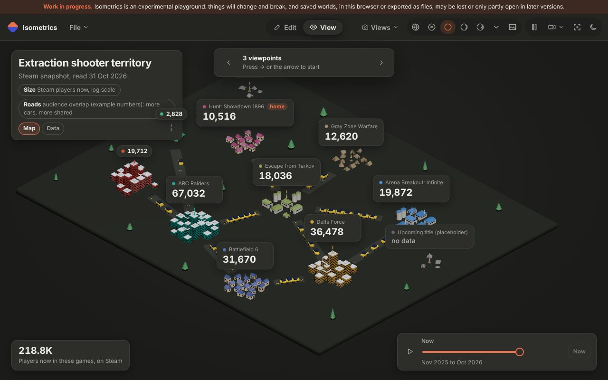 View mode, dark: a cluster per game, cards with counts, no data greyed, the legend, a tile, the story bar | 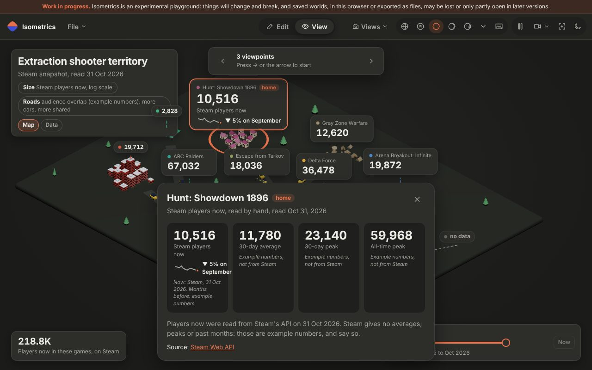 Hunt opened: its ring, its card with "▼ 5% on September", the detail sheet with stat tiles, notes and the source |
| 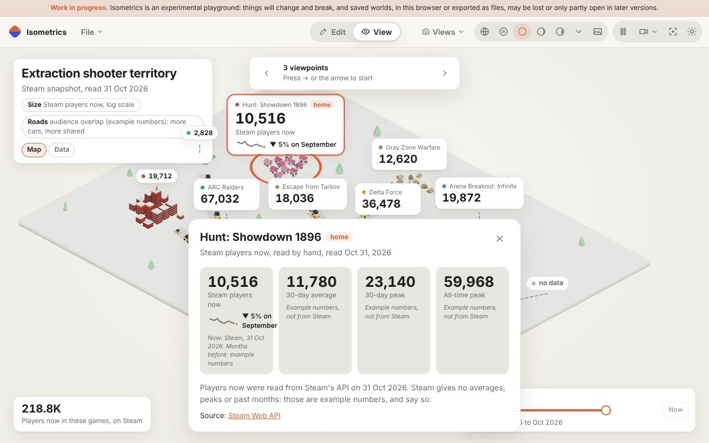 The same in the light theme | 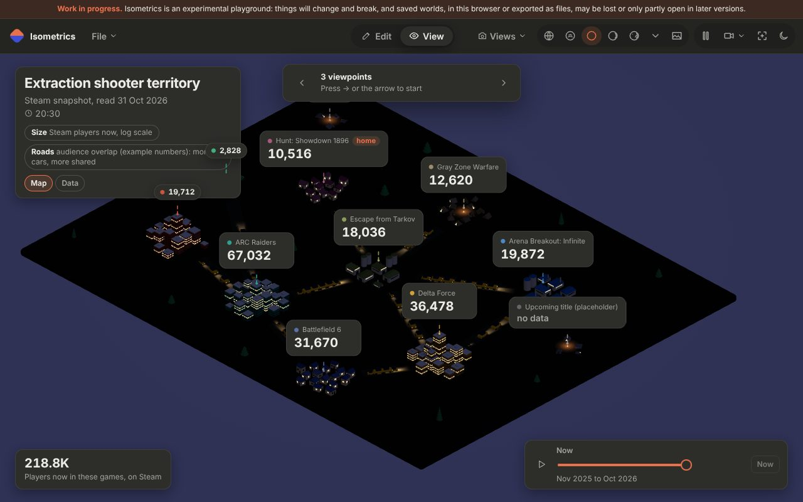 The evening mood: lit windows, camps and headlights on the flows |
| 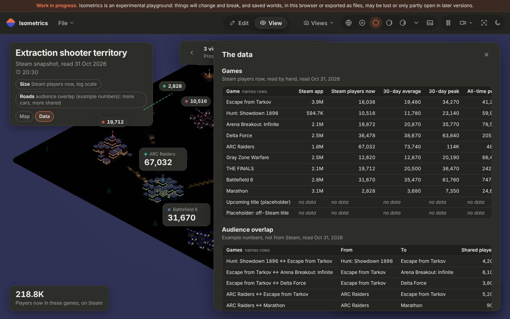 Data: every table and value as tables, with what follows each row |  The story at Nov 2025: Escape from Tarkov and Marathon have no data yet, ARC Raiders and Battlefield 6 near their launch peaks |
| 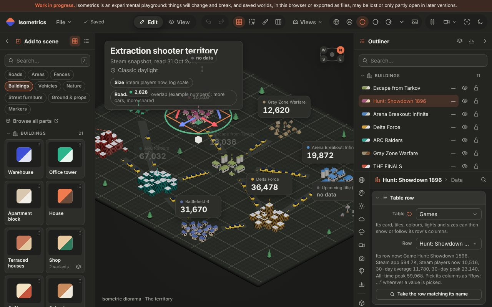 Edit mode: a cluster's Data tab, its table row and Sizes from data | 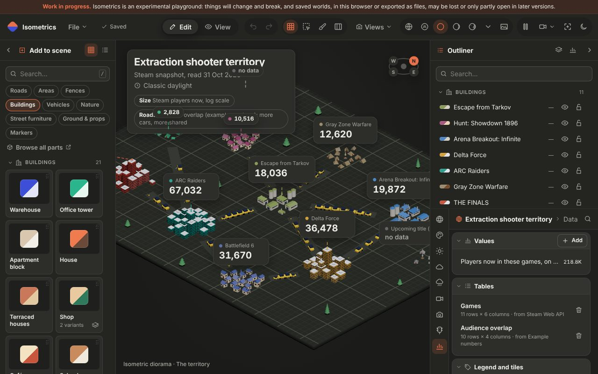 The world's Data tab: values, tables, legend and tiles, sources |

**Battlefield territory**

| | |
|---|---|
| 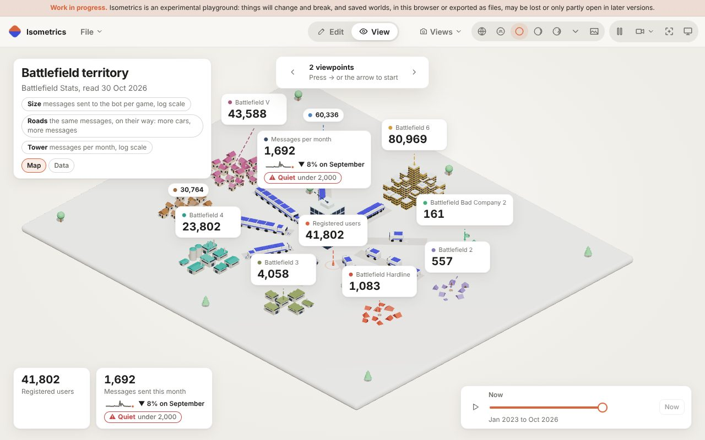 View mode, light: clusters by deliveries, roads to the bot's tower as wide as the deliveries (log scale), vans on them, a live users count (41,802 arrived from the API) | 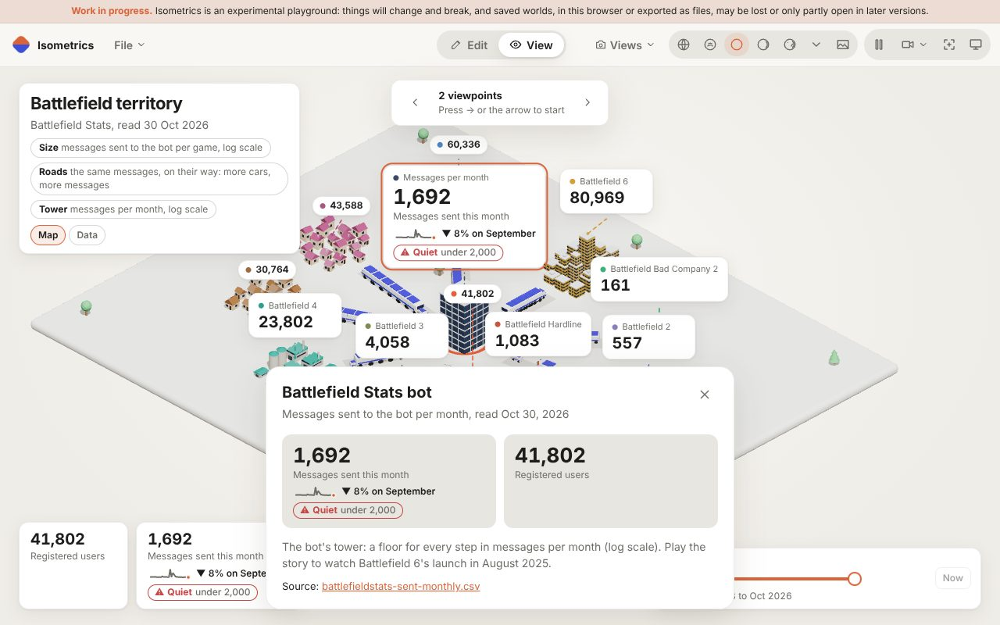 The tower opened: deliveries per month with its sparkline, change and the Quiet watch line |
| 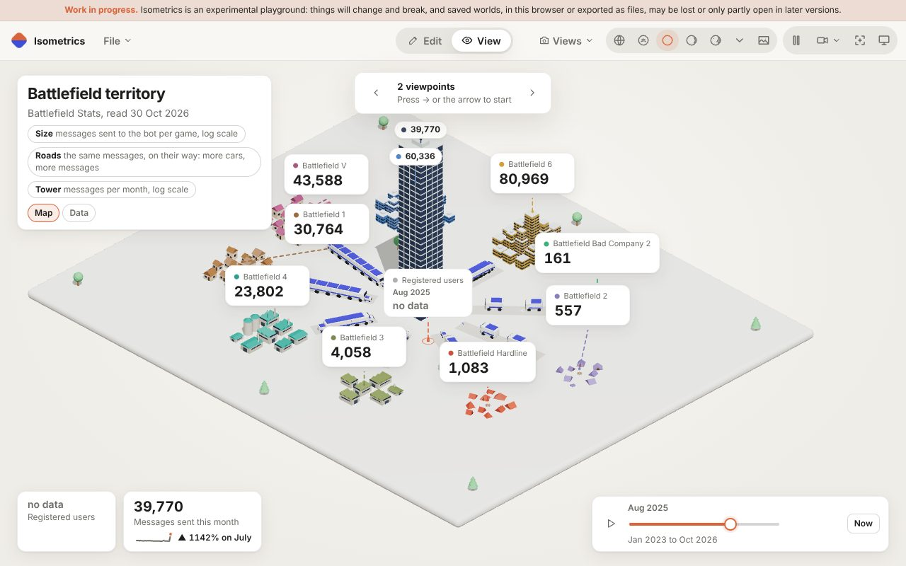 The story at Aug 2025: 39,770 messages, "▲ 1142% on July", the tower at 30 floors | 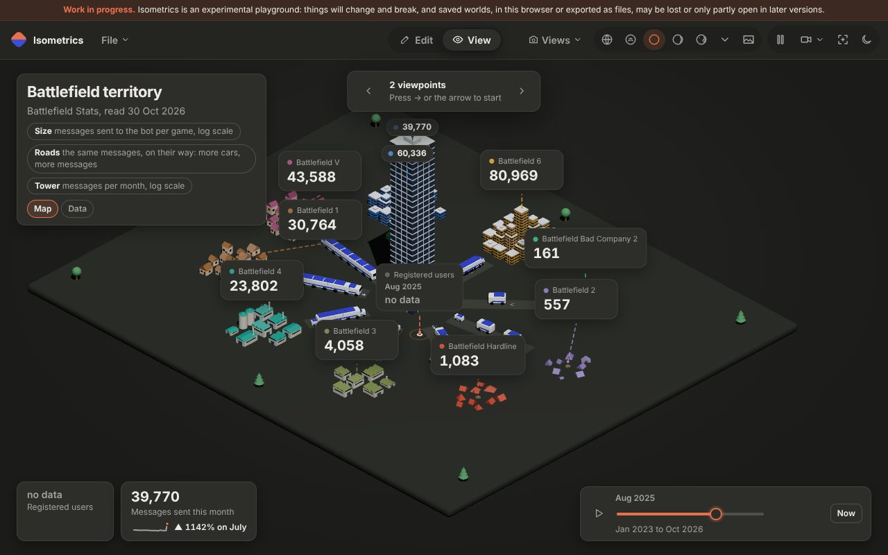 The same in the dark theme |
| 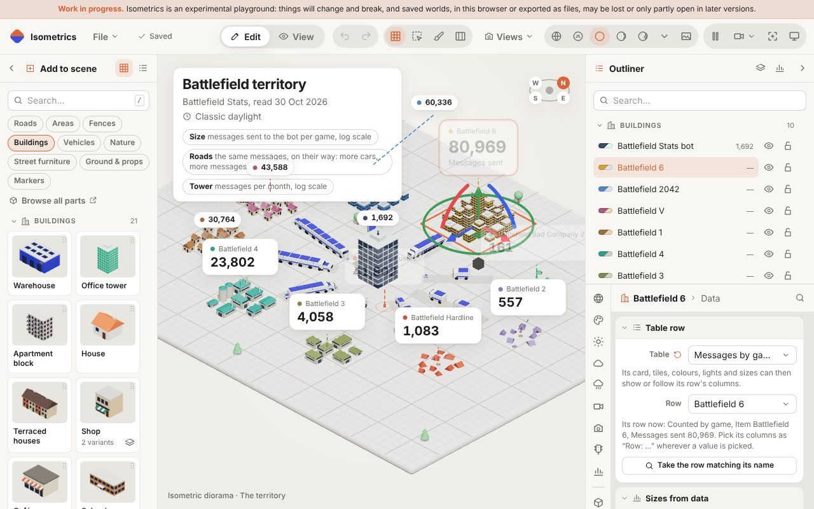 Edit mode: a cluster's Built from its row's messages on a log scale | 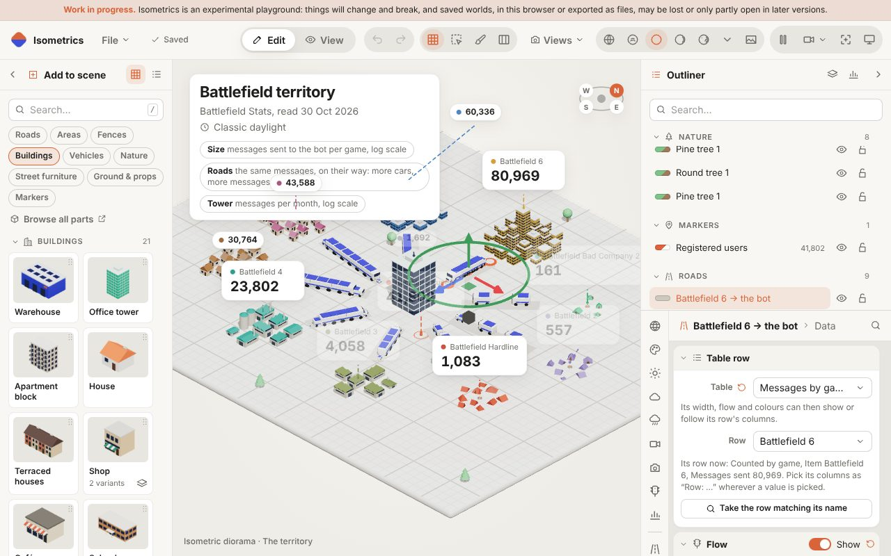 A road's Data tab: its row and its flow's vehicles from data |

**Dialogs**

| | |
|---|---|
| 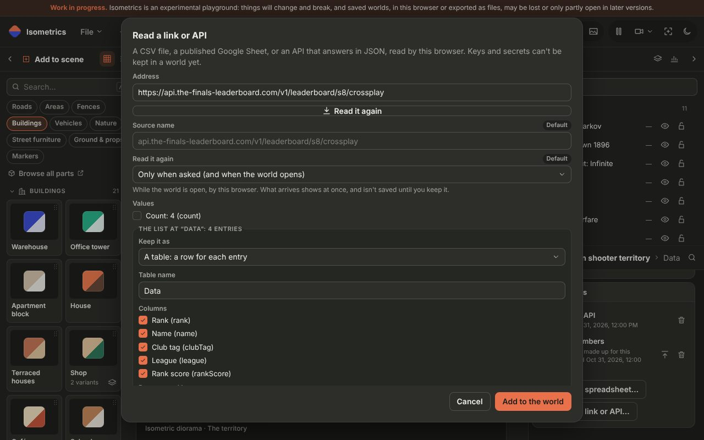 Read a link or API: the Finals leaderboard's list kept as a table | 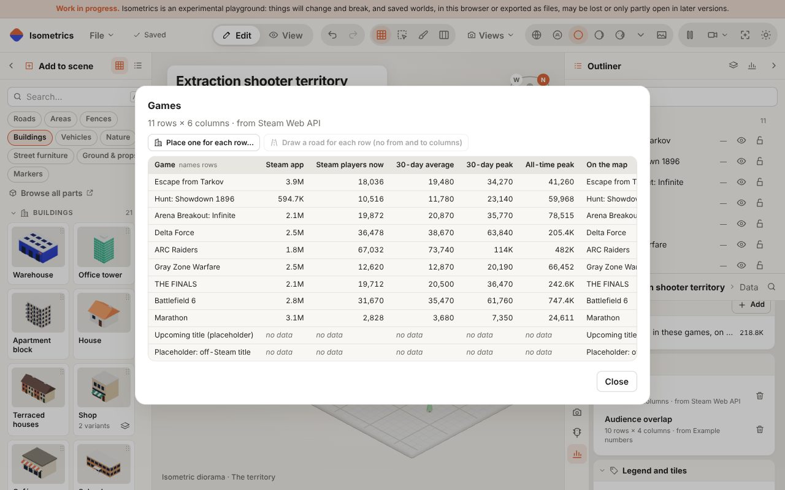 A table's viewer: On the map, Place one for each row, Draw a road for each row |
| 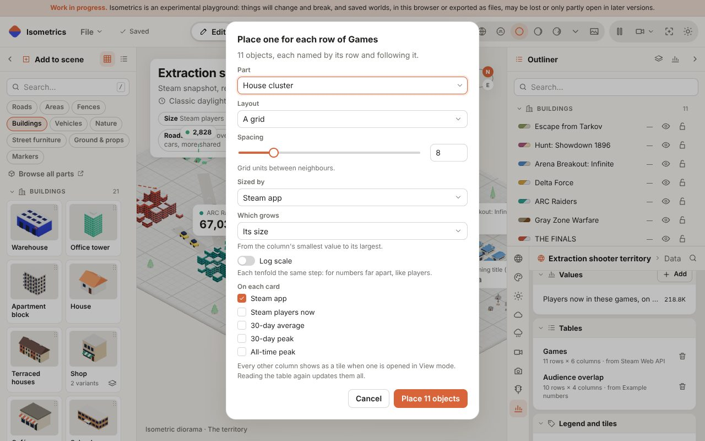 Place one for each row: part, layout, size column on a log scale, card columns | |
