# Rendering study: making Brightwater less flat

A study of how the 3D view could look less flat: what makes it flat today, which effects fix it, what they cost, and whether a WebGPU renderer or a path tracer is worth it. Every picture here is the real app (the starter world, Brightwater) drawn by the prototype (the *render lab*) in headless Chromium.

**Status:** research, finished. The decision is [ADR-0072](../adr/0072-rendering-quality-levels.md) (accepted), which revised this study's proposal with the owner: the default stays today's look, and graphics are customisable with presets and individual settings. The render lab was never merged: it lives on the `claude/rendering-study` branch (PR #3, closed), where the `?fx=…` switches below work.

The same findings with before/after sliders: <https://claude.ai/artifact/5wWXxydpMrjyUD4WchT5X7> (private to the owner unless shared).

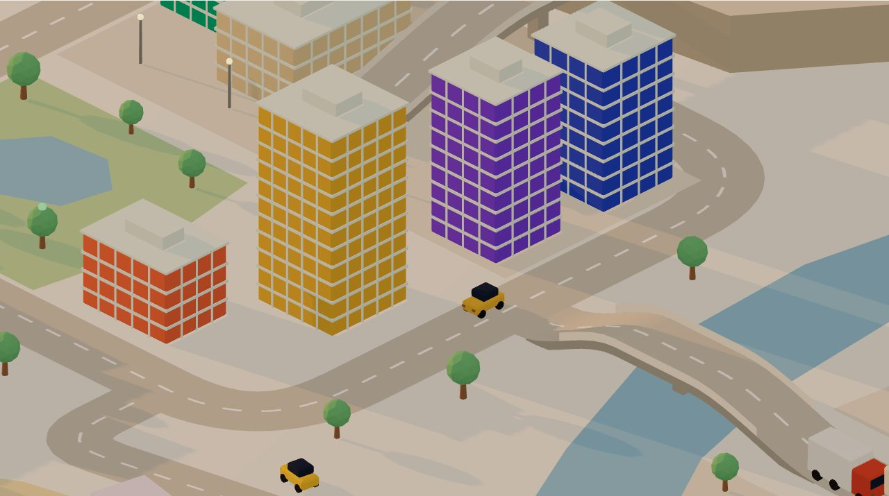
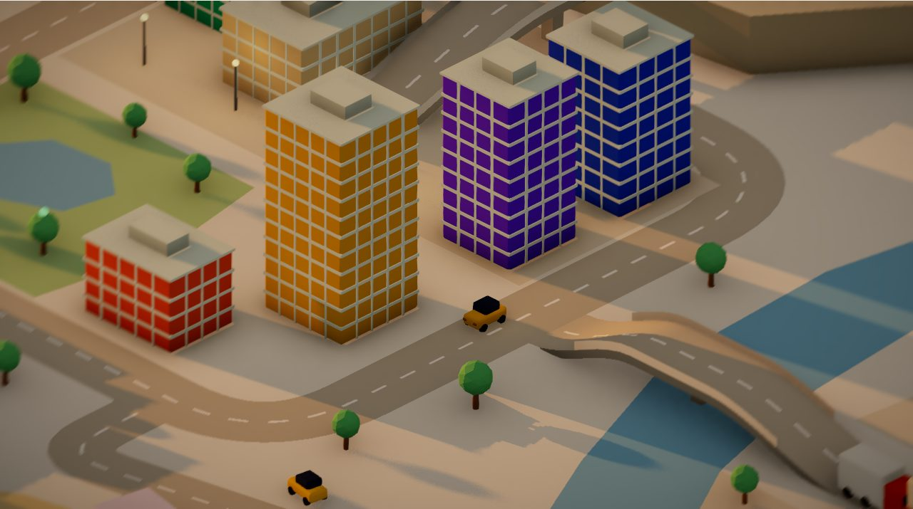

*18:36, golden hour. Top: today. Bottom: stronger sun and weaker fill, ambient occlusion, soft shadows, a light colour grade and tilt-shift.*

## Why it looks flat

Three things, and none of them is the renderer:

1. **The shade is almost as bright as the sun.** The hemisphere and ambient fill lights (`hemiIntensity`, `ambientIntensity` in `scene/theme.ts`) are strong next to the sun (`sunIntensity`), so a building's shaded side is barely darker than its lit side and ground shadows are faint.
2. **Nothing touches anything.** No ambient occlusion: a tower meets the ground with no darkening at its base, corners and gaps are as bright as open ground.
3. **Night lights are painted on** (ADR-0052, ADR-0058). Windows, lamps and headlights glow, and lamps paint a pool on the ground, but nothing is lit by them: the wall next to a lamp stays flat blue.

All three can be fixed on today's WebGL renderer.

## What each change does

Close-up of downtown, one change at a time (`VIEWS=close`).

| | |
|---|---|
| 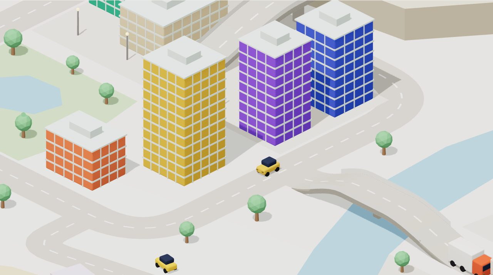 **Today.** Even light, faint shadows, things float. | 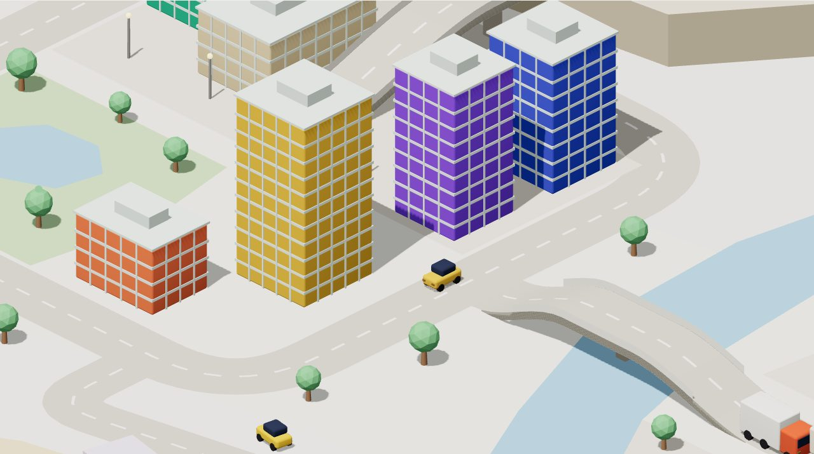 **Sun ×1.3, fill ×0.55** (`fx=key`). Free. Shade reads as shade. |
| 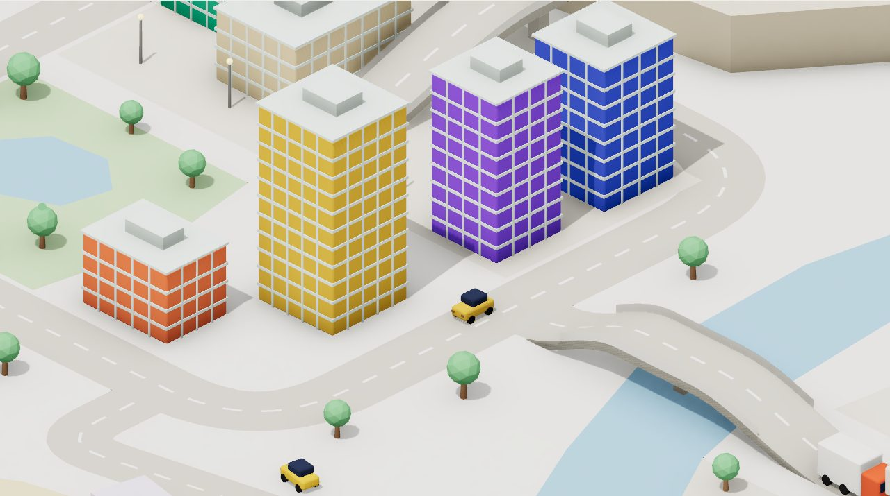 **Ambient occlusion** (`fx=ao`, N8AO half-res). Darkening where things meet. | 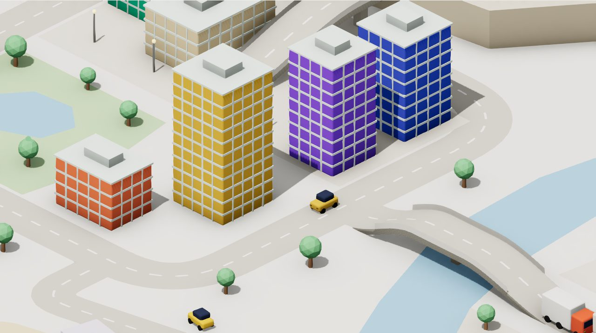 **Both** (`fx=key,ao,smaa`). The biggest gain for the least. |
| 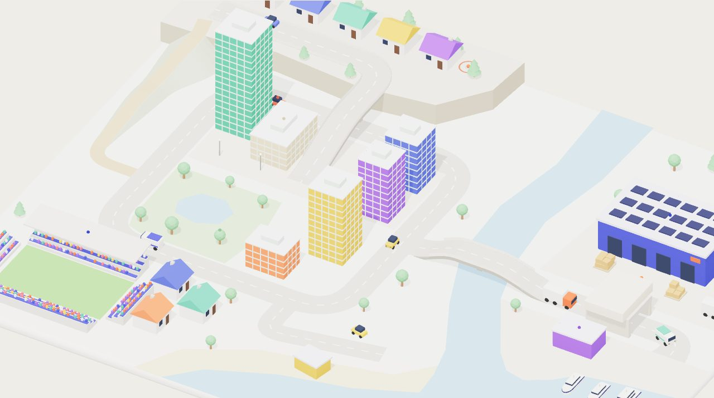 **Sky environment map, added to the fill lights** (`fx=env`, first try): washed out. |  **Environment replacing the fill, tuned:** barely different on matte surfaces. Only pays off with shinier materials (water, glass, paint). |
| 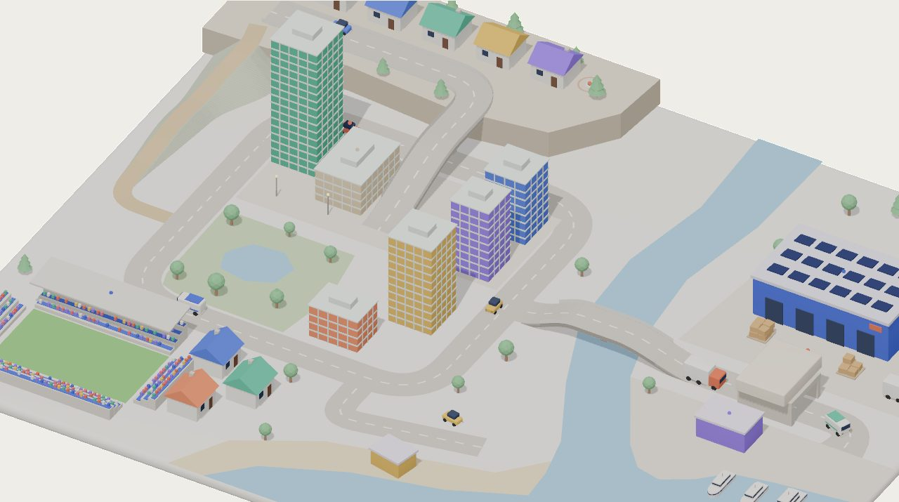 **AgX tone mapping** (`fx=agx`): greyer and muddier. The palettes are tuned for ACES. Not worth it. | |

At night:

| | |
|---|---|
| 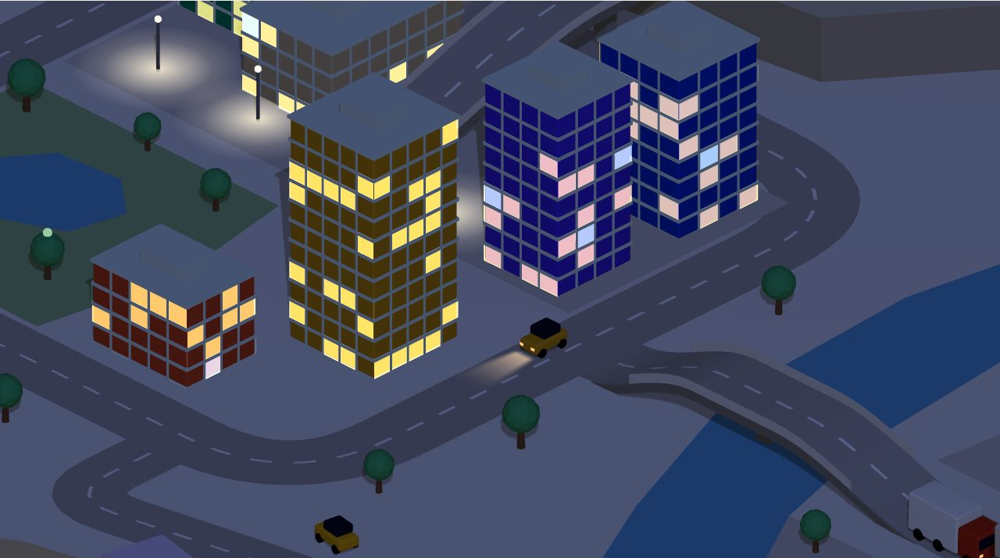 **Today**, 22:00. | 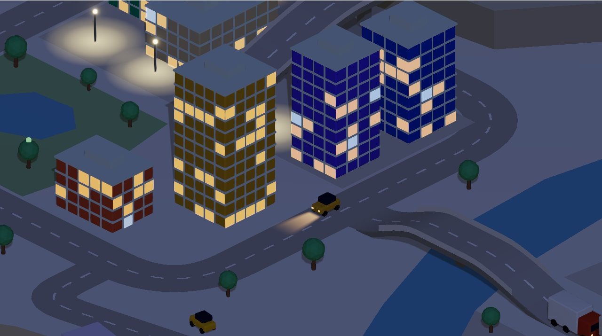 **Bloom** (`fx=bloom,smaa`). Glow, but nothing lit. |
| 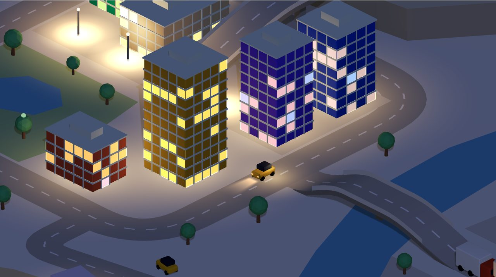 **Real point lights** (`fx=lamps`): one per lamp and lit building, 24 at most. Streets, walls, the passing car get warm light. | 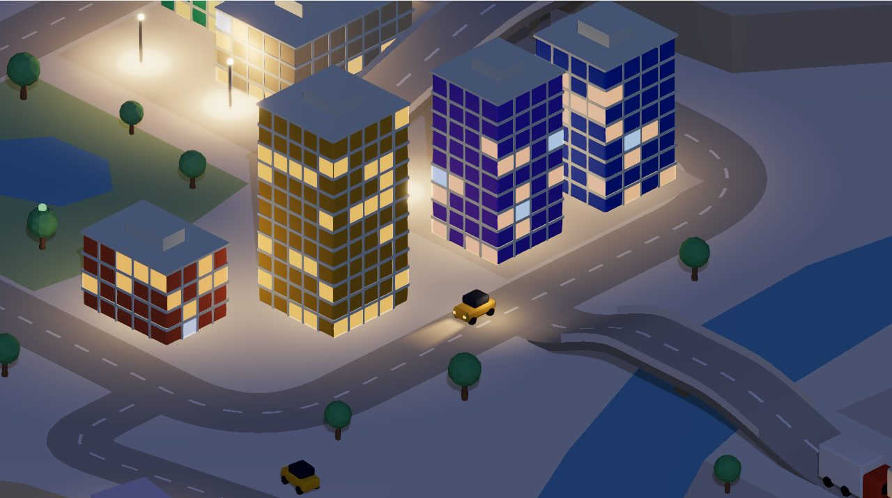 **Both.** |

| | |
|---|---|
| 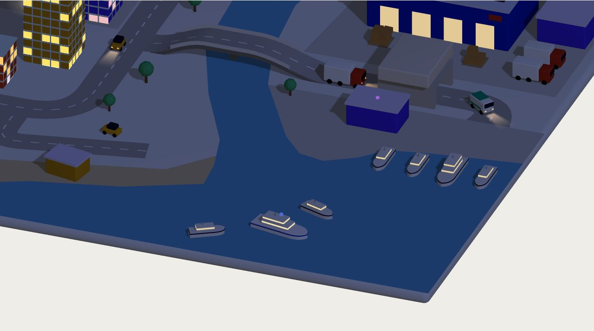 The marina today. | 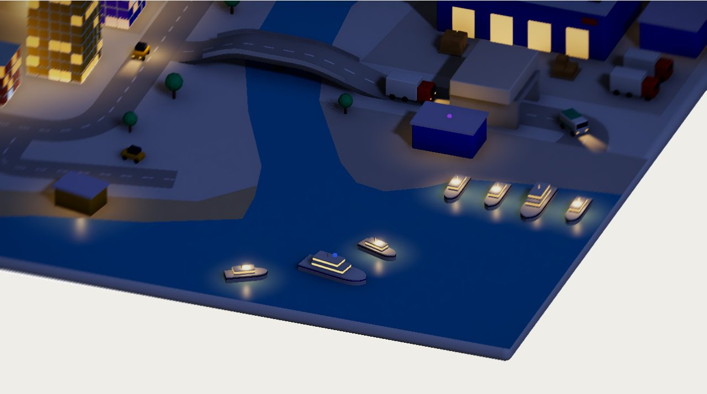 Ultra: yacht cabins and lamps light the water and the quay. |
| 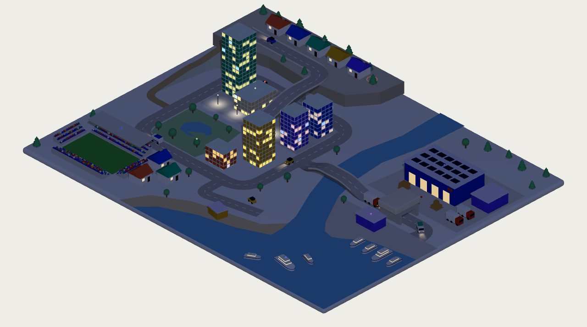 The whole world at 22:00. | 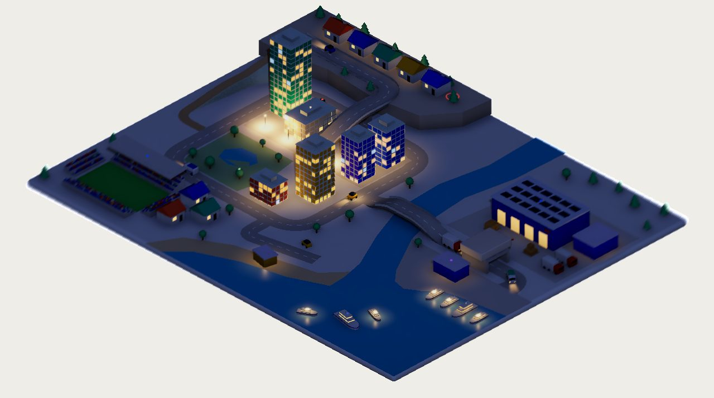 Ultra: downtown and the marina draw the eye, where the cards are. |

**Bloom has to follow the dark.** On at noon it puts a white halo on bright ground and the ground's edge. The lab scales its strength by the time of day's `night` (0–1); see `ultra-close-12` below versus the earlier run in the artifact.

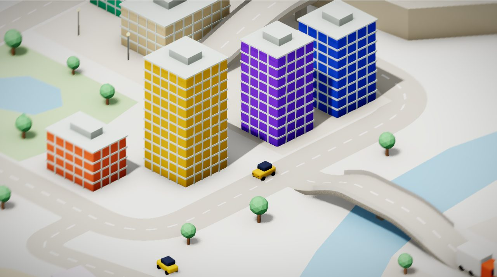

## Proposal: quality levels, like Blender's viewport and render modes

*Superseded:* ADR-0072 keeps today's look as the default (**Standard**), lets each setting be changed on its own, and makes the sun and shade balance a world setting. The study's first proposal, for the record:

A **Quality** preference per browser (like the camera settings, ADR-0062; never stored in the world), with an automatic default from the device:

- **Fast** (phones, old laptops): today's look with the rebalanced sun and fill; painted night lights; no post-processing.
- **Nice** (default on desktop): ambient occlusion (N8AO, half resolution), bloom after dark only, up to ~16 real point lights nearest the view, SMAA instead of MSAA.
- **Ultra** (opt-in): full-resolution AO, soft contact shadows (PCSS), more real lights, a light colour grade, tilt-shift and vignette in the same pass.
- **Render** (a button, not a mode): a path-traced still of the current view, for sharing and thumbnails.


## On a real GPU

Measured afterwards on an RTX 4080 SUPER, in Chrome on Windows (headless, which still uses the GPU there: native D3D11 WebGL and real WebGPU), driven from WSL by Windows' own `node.exe`. GPU time per frame from WebGL timer queries (`EXT_disjoint_timer_query_webgl2`, each animation frame wrapped in a query) and, on WebGPU, three's timestamp queries; the GPU warmed up first, three interleaved repeats within 3%. Frame intervals are no use there: headless, uncapped frames don't wait for the GPU.

GPU ms per frame, downtown close-up, noon / 22:00:

| | 1280×800 | 1920×1080 at 2× density |
|---|---|---|
| Today | 0.44 / 0.64 | 0.61 / ~1.0 |
| `key` (sun ×1.3, fill ×0.55) | 0.41 / 0.64 | 0.66 / 1.02 |
| `ao` alone (with the composer's 4× MSAA) | 1.39 / 1.59 | 4.93 / 5.10 |
| `key,ao,bloom,lamps,smaa` | 1.43 / 1.74 | 3.0 / 4.55 |
| Ultra (`key,ao,bloom,lamps,soft,grade,tilt,smaa`) | 1.36 / 1.82 | 3.68 / 5.06 |

The overview costs about the same at both sizes (today 1.1–1.4 ms, the Nice-like set 2.2–3.9 ms): there, geometry and the shadow map dominate, not pixels. Integrated laptop GPUs are many times slower than this card, so these numbers say "cheap on a strong GPU", not "cheap everywhere".

What the software GPU hid:

- **Ambient occlusion on a multisampled buffer is expensive:** `ao` alone, which keeps the composer's 4× MSAA, cost more than the whole Nice-like set with SMAA. Use SMAA whenever the composer is on.
- **The colour grade (`grade`) turns saturated colours black** (the gold tower, the red block's windows, yellow cars), at any hour, on its own; tilt-shift is fine. SwiftShader drew them correctly.
- **Real WebGPU:** GTAO fails WGSL validation (`textureGather` on a `texture_depth_multisampled_2d`: the scene pass keeps MSAA); with `traa` (no MSAA) it works, at 1.7 ms. The camera jump loses zoom and projection, and the pipeline turns the backdrop black, as in software. **Clustered lighting lit nothing** even on real WebGPU, as the lab wires it (`many`, 0.6 ms, the picture of `bloom` alone); ~100 forward lights (`many,forward`) light the town, at 2.2 ms.
- **WSL and Chromium:** Playwright's Chromium inside WSL reaches the GPU only headed, with `--use-angle=gl`, `GALLIUM_DRIVER=d3d12` and `/usr/lib/wsl/lib` on `LD_LIBRARY_PATH`; WebGPU there is always SwiftShader (no Vulkan driver for the GPU in WSL). Windows' Chrome is the better test bed.

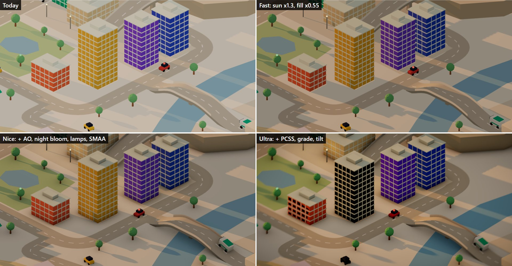
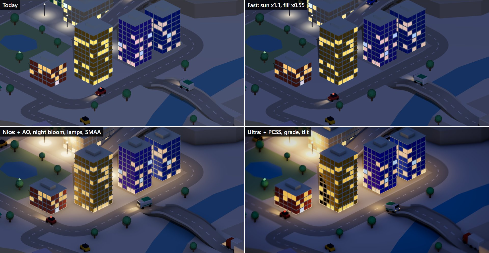
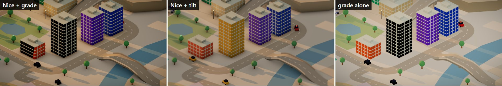
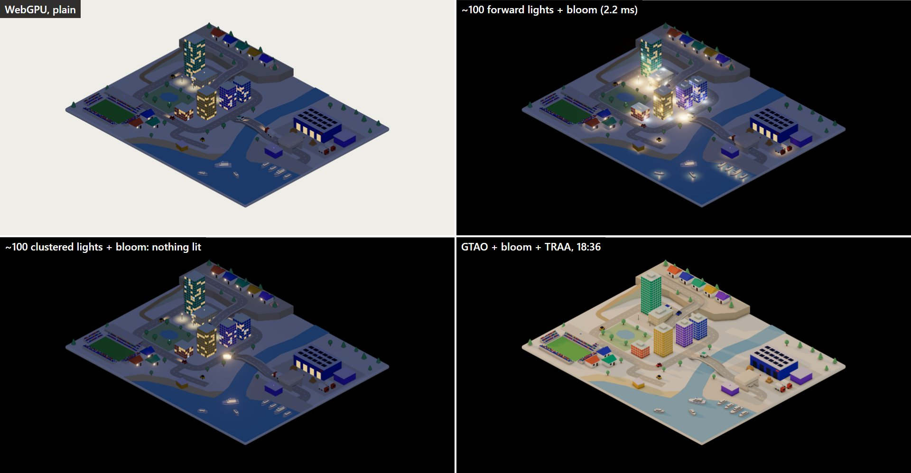

## Costs in software (SwiftShader)

Frame times from SwiftShader (Chromium's software GPU) at 1280×800, as multiples of today's. Software rendering is far slower than any GPU and over-weights texture reads, so only ratios mean anything, and only roughly. A real-device pass belongs in the implementation.

| Change | Look | Frame time vs today | Phones | Work |
|---|---|---|---|---|
| Sun and fill rebalanced | big | ×1.1 | yes | theme numbers, a design pass on both themes, old-world check |
| Ambient occlusion (N8AO, half res) | big | ×3–4 | Nice and up | `@react-three/postprocessing` + `n8ao` |
| Bloom, night only | night | ×1.7 | Nice and up | same composer |
| Real point lights (≤24) | night | ×3.3 | cap lower | lights system declares a real light; nearest-N picker |
| Soft shadows (PCSS) | some | in Ultra | no | drei `SoftShadows` patches shadow shaders globally |
| Tilt-shift, grade, vignette | style | small | yes | fold today's `render/TiltShift.tsx` into the composer |
| Sky environment map | little | ×2.6 (texture reads; cheap on GPUs) | — | only with shinier materials |
| AgX tone mapping | worse | ×1 | — | would need every palette retuned |
| All of Ultra | big | ×5–7 | no | — |
| WebGPU: GTAO + bloom | big | ×2.6 | where WebGPU | migration, below |
| WebGPU: SSGI | untuned | ×4.3 | no | migration + lighting redesign |
| ~100 forward lights | night | ×6 | no | clustered lighting on real WebGPU instead |

## WebGPU

The whole app runs on `WebGPURenderer` with an import alias. Most of what WebGPU adds needs more work.

| | |
|---|---|
| 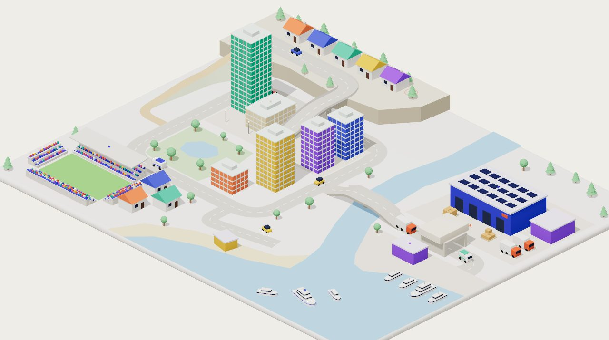 **WebGPURenderer, no changes** (`LAB_WEBGPU=1`, `fx=webgl2`). Parts, roads, areas, shadows, painted lights all draw; plain `meshStandardMaterial` is converted by itself. | 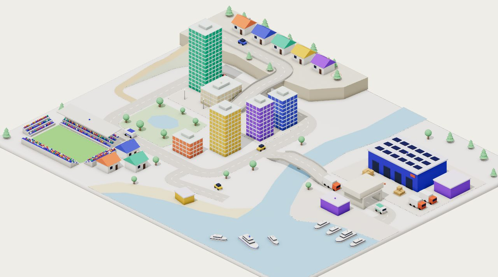 **GTAO through a TSL `RenderPipeline`** (`fx=webgl2,gtao,bloom`). Works, like N8AO. |
| 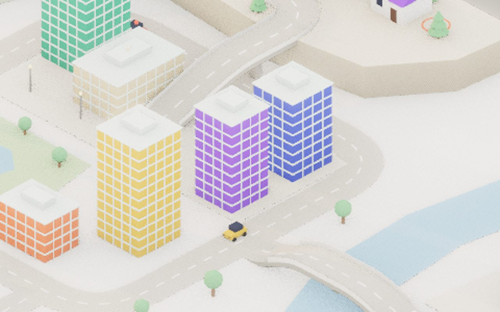 **SSGI (bounce light) out of the box** (`fx=webgl2,ssgi,bloom`): washed out, grainy, golden hour lost. Wants a scene without flat fill lights and a careful composite. | 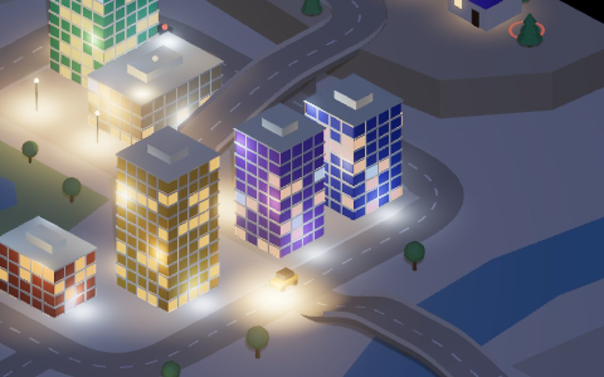 **~100 real lights, forward** (`fx=webgl2,many,forward,bloom`): six round each tower, one per house, yacht and vehicle. Untuned (too bright), ×6 frame time. |

**Software WebGPU crashed in the container** (`createBuffer failed … mappedAtCreation`, then a lost device), so these use the renderer's WebGL 2 backend (`forceWebGL`, `fx=webgl2`): the same node materials and TSL effects. On a machine with a GPU, leave `webgl2` out to try real WebGPU.

What broke, and what migrating would take:

1. **Libraries importing WebGL-only classes.** Aliasing `three` to `three/webgpu` fails the dev build with 57 missing exports (drei's `Environment`, `CubeCamera`, `Preload` want `WebGLCubeRenderTarget`; three's `OutputPass`, `ShaderPass` want `UniformsUtils`). `src/lab/three-hybrid.js` re-exports both builds, which share `three.core.js`, so classes stay single instances; only `PMREMGenerator` clashes and is exported from the WebGPU build. Fine for a migration, not for keeps. Three logs "Multiple instances of Three.js" with the shim; it's the two entry points registering, not two copies of the core.
2. **Hand-written GLSL:** `render/SkyDome.tsx` and `render/TiltShift.tsx` are `ShaderMaterial`s (the renderer logs "Material "ShaderMaterial" is not compatible"). Both need TSL.
3. **drei components with their own shaders:** `Line` (9 uses: label leader lines, road and route handles; "LineMaterial is not compatible"), `Text`, `Grid`. Three has `Line2NodeMaterial`; text needs another approach.
4. **A camera bug:** a viewpoint jump moved and turned the camera but didn't apply its zoom (`span`) or switch to perspective. Not chased.
5. **Transparency:** the pipeline dropped the canvas's alpha; the backdrop went black at night. The WebGL composer has a milder version (a light rim round the ground). With post-processing on, draw the diorama's backdrop (ADR-0070) in the canvas.
6. **Two code paths for lights:** clustered lighting (`ClusteredLighting`, up to 1024 point lights) needs compute shaders, so it exists only on real WebGPU. On the WebGL 2 fallback it lit nothing at all (`fx=webgl2,many`). Browsers without WebGPU need capped forward lights, as in Nice.

Three 0.186 also ships TRAA, SSR, screen-space shadows, depth of field, god rays, LUTs, a light-probe grid and voxel GI (`examples/jsm/lighting/vxgi`), all WebGPU/TSL. Recommendation: ship Fast, Nice and Ultra on WebGL now, and migrate to WebGPU as its own ADR when a feature needs it (hundreds of lights, bounce light, voxel GI).

## Path tracing (the Render button)

`three-gpu-pathtracer` follows light as it bounces, like Blender's Cycles, adding samples while the view stays still. It works on today's WebGL renderer with the live scene (`fx=pt`).

| | |
|---|---|
| 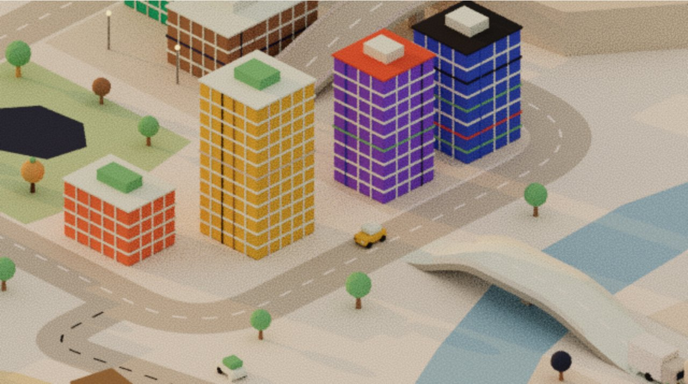 **Golden hour, 35 samples** (about 3 minutes in software; seconds on a GPU). Soft shadows, light bounced off the towers onto the street, a natural warm cast, no tuning. Grainy, and some colours wrong (roof tops, the pond, some trees). | 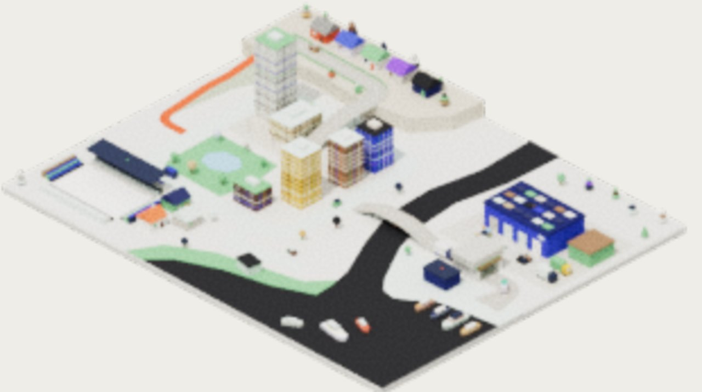 **First try, whole world:** roads gone, water black, window colours off. |

What a Render button needs:

- Hide what the tracer can't read (sky dome, lines, label cards, sprites); it throws `Cannot read properties of undefined (reading 'r')` on the first tile otherwise and stays at 0.11 samples (the lab does this).
- Lift layered flat things (areas, roads, lamp pools) a hair apart: they lie in the ground's plane and rely on draw order and polygon offset, which a path tracer ignores.
- Read colours the way parts set them (per-object colour slots, instances), and give water a real material.
- Replace the hemisphere light with a sky (`GradientEquirectTexture`), which the tracer supports; it ignores hemisphere and ambient lights.
- Light from painted night lights: real lights or emissive surfaces.
- Call `updateCamera()` only when the camera actually moved: every call restarts the samples.

## The render lab

The prototype, on the `claude/rendering-study` branch:

- `src/render/labFlags.ts`: the switches (`?fx=`, `?env=`, `LAB_WEBGPU`), with no three.js, so the viewport checks them without loading the lab.
- `src/render/RenderLab.tsx`: WebGL effects, loaded lazily by `Viewport` only when `?fx=` asks for something.
- `src/render/RenderLabGpu.tsx`: the WebGPU renderer, TSL pipeline and many lights, loaded lazily only on a `LAB_WEBGPU=1` server.
- `src/lab/three-hybrid.js` and `vite.config.ts`: the `three` → WebGPU alias and the `__LAB_WEBGPU__` flag, only with `LAB_WEBGPU=1`.
- `scripts/render-lab/shoot.mjs` and `grid.py`: screenshots and comparison sheets.
- New dependencies: `@react-three/postprocessing`, `postprocessing`, `n8ao`, `three-gpu-pathtracer`, `three-mesh-bvh`. They're only in the lazy lab chunks of a production build (`RenderLab-*.js`, `RenderLabGpu-*.js`); the main bundle is unchanged apart from `labFlags`.

### `?fx=` switches (WebGL, `pnpm dev`)

| Switch | What it does |
|---|---|
| `key` | Sun ×1.3, hemisphere and ambient fill ×0.55 (each frame, after `SceneLights`) |
| `ao` | N8AO ambient occlusion, half resolution, high quality |
| `bloom` | Bloom (mipmap blur, threshold 0.85), strength × the time of day's `night` |
| `lamps` / `lamps64` | Real point lights at lamps, Light parts and lit buildings (24 / 64 at most), strength × `night` |
| `soft` | drei `SoftShadows` (PCSS) |
| `grade` | Saturation +0.12, contrast +0.08, vignette |
| `tilt` | `TiltShift2` in the composer (today's own tilt-shift is a camera setting and a separate pass) |
| `smaa` | SMAA instead of 4× MSAA |
| `env` (+ `&env=0.6`) | A sky environment map from the time of day's colours, fill lights dimmed to 0.15 |
| `agx` | AgX tone mapping |
| `vsm` | VSM shadow maps |
| `pt` | Path tracer (`three-gpu-pathtracer`); `globalThis.__ptSamples` counts samples |

The Ultra pictures: `?fx=key,ao,bloom,lamps,soft,grade,tilt,smaa`.

### WebGPU switches (`LAB_WEBGPU=1 pnpm dev`)

| Switch | What it does |
|---|---|
| `webgl2` | `forceWebGL`: the WebGPU renderer's WebGL 2 backend (needed where WebGPU doesn't work, like SwiftShader) |
| `gtao` | GTAO in a TSL `RenderPipeline` |
| `ssgi` | SSGI (bounce light) instead of GTAO |
| `bloom` | TSL bloom × `night` |
| `traa` | Temporal anti-aliasing (turns MSAA off) |
| `many` | ~100 point lights with `ClusteredLighting` (real WebGPU only) |
| `forward` | With `many`: ordinary forward lights instead of clustered |

### Taking pictures

```sh
pnpm dev                                         # or LAB_WEBGPU=1 pnpm dev -- --port 3001
node scripts/render-lab/shoot.mjs today "" 12 18.6 22
node scripts/render-lab/shoot.mjs ultra "fx=key,ao,bloom,lamps,soft,grade,tilt,smaa" 12 18.6 22
VIEWS=view_marina,view_overview node scripts/render-lab/shoot.mjs night "fx=bloom,lamps" 22
BASE=http://localhost:3001 VIEWS=none node scripts/render-lab/shoot.mjs gpu "fx=webgl2,gtao,bloom" 12
VIEWS=close WAIT=170000 node scripts/render-lab/shoot.mjs pt "fx=pt" 18.6
python3 scripts/render-lab/grid.py compare.png 2 today-close-12 ultra-close-12
```

Pictures go to `scripts/render-lab/shots/` (ignored by git).

### Gotchas met along the way

- **Camera jumps on WebGPU:** the renderer starts asynchronously; a `flight` set before it's ready is lost (the script waits 4 s). On WebGPU, zoom and projection from a jump didn't apply (above), so its pictures use the opening view (`VIEWS=none`).
- **Dev servers jam on error floods:** a crashed WebGPU device logs errors every frame, Vite forwards them to its terminal, and the server stopped answering (both servers on the machine did). Stop the server and start it again; kill stray Chromiums.
- **Don't `pkill -f` a pattern that's in your own command line**: it kills the shell running it.
- **Playwright's browser build:** this repo's Playwright expects its own Chromium build; where a different one is installed, `CHROME=/path/to/chrome` for the script, or a temporary config with `executablePath` for `pnpm e2e`.
- **Bloom in daylight** halos bright ground: scale it by `night`.
- **Environment maps** must replace the flat fill lights, not add to them.
- **Effects and the transparent canvas:** the backdrop is the page behind the canvas (ADR-0070); post-processing leaves a rim (WebGL composer) or turns it black (TSL pipeline). Draw the backdrop in the canvas.
- **SwiftShader frame times** are relative only; texture-heavy effects look far worse there than on a GPU.

## What came of it

ADR-0072 (accepted) and the TODO entry *Less flat: graphics settings* hold the plan: a world setting for the contrast between sun and shade, a Graphics page in Preferences (presets Standard, Nice and Ultra, each setting following the preset until changed) drawn by one effects composer, real night lights from the lights system, later a path-traced Render button, and WebGPU as its own decision. The lab isn't merged; the real features are built from `main`.
